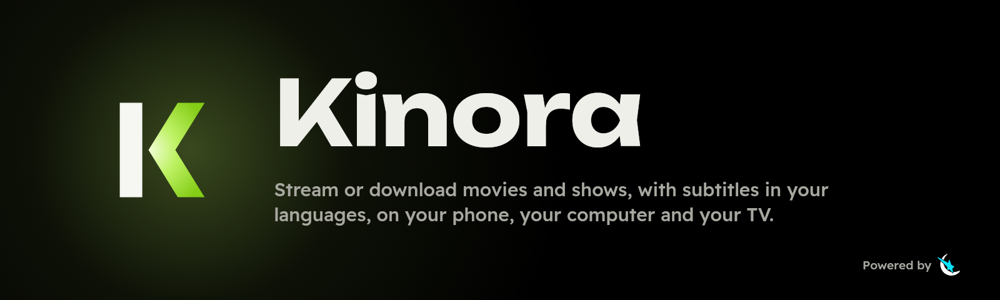
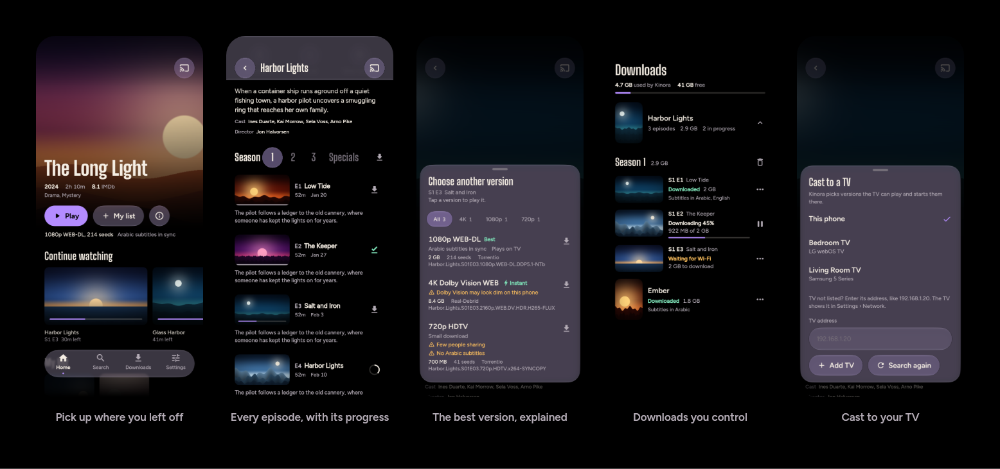
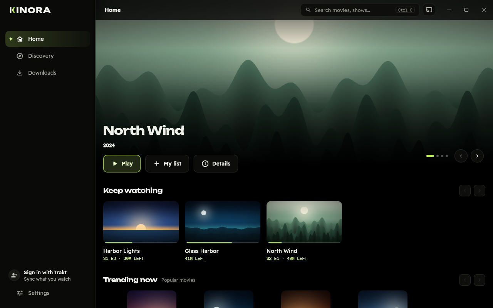

<p align="center">
  
</p>

<p align="center">
  <a href="https://github.com/abdvlrqhman/kinora/releases/latest"></a>
  <a href="https://github.com/abdvlrqhman/kinora/actions/workflows/app.yml"></a>
  
  <a href="LICENSE"></a>
</p>

<p align="center">
  <a href="https://github.com/abdvlrqhman/kinora/releases/latest/download/Kinora.ipa"><b>Download for iPhone</b></a>
  &nbsp;&nbsp;&nbsp;
  <a href="https://github.com/abdvlrqhman/kinora/releases/latest/download/Kinora-arm64-v8a-release.apk"><b>Download for Android</b></a>
  &nbsp;&nbsp;&nbsp;
  <a href="https://github.com/abdvlrqhman/kinora/releases/latest/download/Kinora-Setup-x64.exe"><b>Download for Windows</b></a>
</p>

Kinora plays movies and shows from torrents and debrid services in one player.
For every episode it picks the best version for your screen and your
subtitle languages, and says why. It casts to your TV, keeps what you watch
as downloads, and keeps everything on your device: no Kinora account, no
tracking. Sign in to Trakt if you like, and what you watch follows you
everywhere.

<p align="center">
  
</p>

## What it does

- **The best version, explained.** Every episode is matched against all your
  sources and checked live with the trackers. It's then scored for your
  phone, or for your TV while casting, and for subtitles in your languages.
  The Play button says what it picked and why, and every other version is
  one tap away.
- **One player for streams and downloads.** It plays any format, names audio
  tracks by language and channels, and groups subtitles by language. You get
  timing, style, speed, skip intro, next episode and an episode list.
  Swipe for brightness and volume, pinch to zoom, and use picture-in-picture
  on Android. Your audio and subtitle choice is remembered for each show.
- **Subtitles from many sites.** OpenSubtitles works without a key; SubDL,
  SubSource, Wyzie and Jimaku take your own. Lines can be synced with one
  tap: "Line is spoken now".
- **Downloads that keep going.** Torrents keep downloading with the screen
  off, and debrid links go through the system downloader. Episodes you
  stream to the end are kept as downloads, with their best subtitles.
- **Cast to your TV.** DLNA, tuned for Samsung, with subtitles. Kinora warns
  you before casting a version the TV can't play, and rides out Wi-Fi
  hiccups.
- **Discovery.** Browse your sources' catalogs by type and genre, search
  them all at once, or paste a magnet or video link to play it.
- **Trakt, if you like.** Sign in with a code at trakt.tv (Kinora never sees
  your password): what you watched, where you stopped and your watchlist
  stay the same on every device, and in apps like Stremio and Kodi.
- **Backup.** Move your sources and keys to another device as a code locked
  with a passphrase you choose. Kinora keeps no copy anywhere.
- **On your computer too.** A Windows app in its own window, with a sidebar,
  keyboard shortcuts (Space, the arrows, F for full screen, Ctrl+K to
  search) and the mouse's back button.
- **Updates in the app.** Kinora tells you when a new version is out and
  shows what changed. You can turn this off in Settings › About.

## Install

**Android 8 or later**

1. Download [`Kinora-arm64-v8a-release.apk`](https://github.com/abdvlrqhman/kinora/releases/latest/download/Kinora-arm64-v8a-release.apk).
   For an older 32-bit phone, download
   [`Kinora-armeabi-v7a-release.apk`](https://github.com/abdvlrqhman/kinora/releases/latest/download/Kinora-armeabi-v7a-release.apk)
   instead.
2. Open it and allow installs from your browser when Android asks.

Updates install over the previous version and keep your data.

**iPhone with iOS 15 or later**

The iPhone build is unsigned, so it installs through
[SideStore](https://sidestore.io) with your own free Apple ID.

1. Set up SideStore on your iPhone (see its guide).
2. Download [`Kinora.ipa`](https://github.com/abdvlrqhman/kinora/releases/latest/download/Kinora.ipa)
   and open it with SideStore.
3. When Kinora offers an update, tap **Update with SideStore**.

Apps installed with a free Apple ID run for 7 days at a time, and SideStore
refreshes them. If Kinora stops opening, open SideStore and refresh it.

**Windows 10 or 11 (64-bit)**

1. Download [`Kinora-Setup-x64.exe`](https://github.com/abdvlrqhman/kinora/releases/latest/download/Kinora-Setup-x64.exe)
   and open it. Kinora isn't code-signed, so Windows may say it protected
   your PC: choose **More info**, then **Run anyway**.
2. It installs for you alone (no administrator needed), with Kinora in the
   Start menu. Remove it from **Settings › Apps** like any other app.
3. When Kinora offers an update, open the installer it downloads: it updates
   Kinora in place. Your library and settings stay, also if you uninstall.

Prefer no installer? [`Kinora-windows-x64.zip`](https://github.com/abdvlrqhman/kinora/releases/latest/download/Kinora-windows-x64.zip)
is the same app: unzip it anywhere and open `Kinora.exe`.

<p align="center">
  
</p>

Every release is listed on the [Releases](https://github.com/abdvlrqhman/kinora/releases)
page, with what changed.

## First run

1. Pick your subtitle languages in order (for example Arabic, then English),
   and whether you prefer the original audio.
2. Add your sources. Kinora comes with none: paste the manifest link of any
   Stremio-compatible addon you choose. Cinemeta (catalogs) and OpenSubtitles
   (subtitles) are offered as one-tap suggestions.
3. Optional:
   - Add your own keys for more subtitle sites.
   - Add a TMDB key for cast, photos and "More like this".

   Keys stay in the device's secure storage (Keychain, Keystore or the
   Windows credential store).
4. Moving from another device? Restore your sources and keys from a backup
   code on the sources step.

## Privacy

Kinora has no accounts, no analytics and no ads. It only connects to:

- the sources and subtitle sites you add;
- TMDB, if you add a key;
- Trakt, if you sign in: what you play, your progress and your watchlist
  sync with your Trakt account, and signing out of Kinora revokes its access;
- the torrent swarm, plus a public tracker list it refreshes daily;
- GitHub, once per launch, to check for a new version (you can turn this
  off).

Logs stay on your device. **Settings › Diagnostics › Copy diagnostics** gives
you a copy to share, with keys and addon links left out.

## Questions

<details>
<summary><b>Kinora doesn't find my TV</b></summary>

- Put the phone on the same Wi-Fi as the TV.
- On iPhone, allow Kinora in **Settings › Privacy & Security › Local
  Network**.
- Still not listed? Enter the TV's address in the cast picker. The TV shows
  it in its network settings.
</details>

<details>
<summary><b>The TV stops or says the video can't play</b></summary>

- Keep the phone on Wi-Fi while casting: the TV plays from the phone.
- Kinora reloads the video on the TV if the TV's player fails. If it keeps
  failing, choose another version: the version list marks the ones the TV
  can play.
</details>

<details>
<summary><b>Downloads stopped after I restarted my phone</b></summary>

Open Kinora once: unfinished torrent downloads need the app running. On
Android, a notification tells you how many are waiting.
</details>

<details>
<summary><b>Where are my downloads?</b></summary>

- **iPhone:** in the Files app, under On My iPhone › Kinora.
- **Both:** Kinora's Downloads tab lists them by show and season. You can
  delete any episode, season or show, and clear every cache in Settings ›
  Storage.
</details>

<details>
<summary><b>Windows says it protected my PC</b></summary>

Kinora isn't code-signed, so Windows SmartScreen warns about it the first
time. Choose **More info**, then **Run anyway**. Windows Firewall may also
ask once: allow Kinora on private networks so your TV can play from it.
</details>

<details>
<summary><b>Subtitles are out of sync</b></summary>

In the player, open **Audio and subtitles**, wait for the line to be said,
and tap **Line is spoken now**. Hold − or + to move the subtitles a whole
second.
</details>

## Build it yourself

Everything builds in GitHub Actions, so you don't need a Mac, a Windows PC
or a local toolchain. Fork the repo, and the `app` workflow builds the APKs,
the IPA and the Windows installer and zip, and runs every test, including the end-to-end
tests on an Android emulator, an iPhone simulator and Windows.

To work locally you need [Flutter 3.47.7](https://docs.flutter.dev/install).

```sh
cd app
flutter pub get
flutter analyze
flutter test        # unit, widget and screen (golden) tests
```

A device build also needs the engine's libtorrent libraries. Download them
from a recent `app` or `engine` run. If they have expired after 7 days, run
the `engine` workflow on your fork first. Then unpack them where the app
expects them:

```sh
gh run download <run-id> -n libtorrent-arm64-android -D packages/engine/prebuilt/arm64-android
gh run download <run-id> -n libtorrent-arm64-ios     -D packages/engine/ios/prebuilt
```

| Workflow | What it does |
|---|---|
| `app` | Analyzes and tests the app and every package. Builds the Android APKs, the unsigned iPhone IPA and the Windows installer and zip (installs, starts and uninstalls it once), and runs the end-to-end test on an Android emulator, an iPhone simulator and Windows. Tagging `vX.Y.Z` publishes a release. |
| `engine` | Builds libtorrent 2.1 with OpenSSL and Boost for Android, iPhone (and its simulator), Linux and Windows, then runs a native end-to-end test of the engine on Linux and Windows. |

## Repository

| Path | What |
|---|---|
| [`app/`](app) | The Flutter app |
| [`packages/engine`](packages/engine) | libtorrent session and HTTP range streaming server (C++ with a Dart FFI layer) |
| [`packages/stremio`](packages/stremio) | Stremio addon protocol client and aggregator |
| [`packages/swarm`](packages/swarm) | Magnet links, live tracker scraping, tracker lists |
| [`packages/release_parser`](packages/release_parser) | Release-name parser |
| [`packages/ranking`](packages/ranking) | Picks the best version and explains it |
| [`packages/subtitles`](packages/subtitles) | Subtitle sites, matching, charsets, formats |
| [`packages/dlna`](packages/dlna) | TV discovery and control (Samsung extensions) |
| [`DESIGN.md`](DESIGN.md) | The design system: colors, type, layout, motion |
| [`PLAN.md`](PLAN.md) | Architecture and the decisions behind it |

## Contributing

Bug reports, ideas and pull requests are welcome. See
[CONTRIBUTING.md](CONTRIBUTING.md). To report a security problem, see
[SECURITY.md](SECURITY.md) and don't open a public issue.

## Sources and the law

Kinora is a media player and a BitTorrent and HTTP client. It comes with no
content, no stream addons and no API keys: you add the addons and keys you
choose. You are responsible for what you access, and for following the laws
where you live.

## License and credits

Kinora is free software under the [GPL-3.0](LICENSE). Third-party components
keep their own licenses.

Built with [Flutter](https://flutter.dev),
[libtorrent](https://libtorrent.org), [mpv](https://mpv.io) (through
[media_kit](https://github.com/media-kit/media-kit)) and
[window_manager](https://pub.dev/packages/window_manager).
Type: [Unbounded](https://fonts.google.com/specimen/Unbounded),
[Readex Pro](https://fonts.google.com/specimen/Readex+Pro) and
[Geist Mono](https://fonts.google.com/specimen/Geist+Mono), all under the
SIL Open Font License.

Powered by [Spacie](https://spacie.net).

Kinora uses [Trakt](https://trakt.tv) but is not endorsed or certified by
Trakt.
